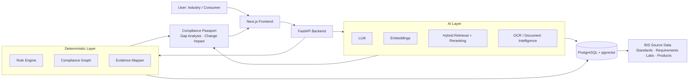

<div align="center">

# 🇮🇳 BIS SAKSHAM

### Turning Standards into Strength.

**AI-Powered Intelligent Assistant for Indian Standards & BIS Services for Industries and Consumers**

`Product Description → Applicable Standards → Testing → Evidence → Compliance`


</div>

---

## 📑 Table of Contents

- [About the Problem](#-about-the-problem)
- [Our Solution](#-our-solution)
- [Key Innovations](#-key-innovations)
- [System Architecture](#-system-architecture)
- [Technology Stack](#-technology-stack)
- [AI + Deterministic Intelligence](#-ai--deterministic-intelligence)
- [Trust & Safety](#-trust--safety)
- [Target Users](#-target-users)
- [Why BIS SAKSHAM?](#-why-bis-saksham)
- [Prototype Scope](#-prototype-scope)
- [Demonstration Flow](#-demonstration-flow)
- [Project Structure](#-project-structure)
- [Getting Started](#-getting-started)
- [Testing](#-testing)
- [Security](#-security)
- [Future Scope](#-future-scope)
- [Team](#-team)
- [Disclaimer](#-disclaimer)

---

## 🏛️ About the Problem

The Bureau of Indian Standards (BIS) is India's National Standards Body. It works across standardization, product certification, conformity assessment, laboratory services, hallmarking, consumer affairs, training and related information services.

For industries and consumers, the challenge is often not simply *finding* information. The real challenge is:

> **"What does this information mean for my specific product, and what should I do next?"**

A manufacturer may need to determine:

- Which Indian Standards are relevant to the product?
- Which requirements are mandatory?
- Does a QCO (Quality Control Order) affect the product?
- What tests are required, and which documents are needed?
- Which components may have additional requirements?
- Which laboratories can perform the required tests?
- What evidence is still missing?
- Has a relevant requirement changed?

BIS already provides several information and service channels, including *Know Your Standard*, laboratory information and certification-related resources.

**The gap:** the information exists, but users still have to connect the dots themselves. BIS SAKSHAM is designed to bridge that gap.

---

## 💡 Our Solution

**BIS SAKSHAM** is an AI-powered, product-centric standards and compliance intelligence platform. It turns a product description, BOM or technical document into an **evidence-backed BIS compliance journey**.

Instead of asking users to search through disconnected information, it builds a structured relationship between:

```
PRODUCT → STANDARDS → REQUIREMENTS → TESTS → LABORATORIES → DOCUMENTS → EVIDENCE → COMPLIANCE JOURNEY
```

> ### AI can explain compliance. AI cannot invent compliance.

- **AI** handles language, product understanding, document analysis and explanations.
- **Deterministic logic** handles compliance-critical decisions: applicability, requirement states, relationships and evidence mapping.

### What makes it different?

BIS SAKSHAM is **not another chatbot**. It is a **Product Compliance Intelligence Platform**.

Instead of answering *"Search for Standard X"*, it aims to answer:

> *"For my product, what standards and requirements may apply, what evidence do I have, what is missing, which tests are needed, and what should I do next?"*

---

## ✨ Key Innovations

### 1️⃣ 🧠 AI Product Profiler

Describe a product naturally:

> *"I want to manufacture a 25L electric storage water heater for domestic use."*

The system extracts relevant product attributes and identifies what still needs clarification. **It never fabricates missing attributes.**

```
Natural Language Description → Attribute Extraction → Product Classification
        → Clarifying Questions → Structured Profile
```

### 2️⃣ 🗺️ BIS Compliance Graph

A connected, explorable view of the compliance ecosystem around a product, so users navigate relationships instead of isolated information pages.

### 3️⃣ 📦 BOM Compliance Dependency Analyzer

Upload a **CSV, XLSX or PDF** BOM. The system analyzes components and flags potential BIS-related dependencies.

| Component | Status | Possible Dependency |
|---|---|---|
| Heating Element | 🟡 Potentially Applicable | Related requirement |
| Thermostat | 🟢 Reviewed | No additional requirement identified |
| Power Cable | 🟡 Potentially Applicable | Relevant standard |
| Housing Material | 🔵 Needs Verification | Additional information required |

**Status model:** `CONFIRMED` · `POTENTIALLY APPLICABLE` · `NO REQUIREMENT IDENTIFIED` · `NEEDS VERIFICATION`

Every flagged component provides: **Why → Evidence → Source → Next Action**

### 4️⃣ 🧪 Test-to-Lab Optimizer

Rather than showing a laboratory directory, it answers: *which laboratory, or combination of laboratories, can cover the outstanding tests?*

```
Outstanding Tests: Electrical Safety · Leakage Current · Temperature Rise

LAB A → 3 / 3 tests
LAB B → 2 / 3 tests
LAB C → 1 / 3 tests
```

This builds on BIS's Indian Standard-wise and laboratory-wise testing information.

### 5️⃣ 📄 Document Intelligence

Upload test reports, datasheets, BOMs, technical specifications, certificates, declarations and supporting documents.

```
Document → OCR / Text Extraction → Structured Information
        → Requirement Matching → Evidence Identification → Gap Analysis
```

### 6️⃣ 🔍 Compliance Gap Analysis

Compares **what is required** against **what evidence is available**, turning compliance from a document-search problem into an actionable checklist.

| Requirement | Expected Evidence | Uploaded Evidence | Status |
|---|---|---|---|
| Electrical Safety | Test Report | Not Found | 🔴 Missing |
| Product Specification | Datasheet | Found | 🟢 Satisfied |
| Material Information | Material Declaration | Partial | 🟡 Review |

### 7️⃣ 📑 Product Compliance Passport

A structured record of the product's compliance journey: product profile, applicable standards, requirements, QCO information, tests, laboratories, documents, evidence, open gaps, regulatory changes, verification status and source references.

```
PRODUCT → DISCOVER → VERIFY → TEST → PROVE → TRACK
```

> The passport is **not** an official BIS certificate. It is an AI-assisted information and workflow representation.

### 8️⃣ ⚠️ Compliance Change Impact Engine

Instead of a generic *"New update available"*, it asks: **"Could this change affect your product?"**

```
⚠ CHANGE DETECTED
Affected Product   : Electric Storage Water Heater
Potential Impact   : Requirement review needed
Effective Date     : [Verified / Demo Date]
Recommended Action : Review affected requirement
```

Demo or simulated changes are clearly labelled and never presented as live regulatory facts.

### 9️⃣ 🔎 Evidence-Backed AI

Every compliance-critical answer is traceable to its source.

```
Source    : BIS
Document  : [Document Name]
Section   : [Section]
Page      : [Page]
Published : [Date]
[ Open Source ]
```

If sufficient evidence is unavailable, the answer is **Needs Verification**. The system never manufactures a standard, clause, QCO, date or compliance requirement.

### 🔟 🤖 Contextual AI Assistant: "Ask SAKSHAM"

The assistant understands the user's current product and workflow. Users can ask:

- Why is this requirement applicable?
- What evidence am I missing?
- Which test should I complete next?
- What changed?
- Explain this requirement simply.
- Show me the source.

It answers from available evidence and flags uncertainty when verification is required.

---

## 🧩 System Architecture



---

## 🏗️ Technology Stack

| Layer | Technologies |
|---|---|
| **Frontend** | Next.js, TypeScript, Tailwind CSS, shadcn/ui, Framer Motion, React Flow, Recharts, Leaflet, Lucide React |
| **Backend** | Python, FastAPI, SQLAlchemy, PostgreSQL, pgvector |
| **AI / Intelligence** | LLM, Embeddings, Hybrid Retrieval, Semantic Search, Reranking, OCR, Document Intelligence, Rule Engine |
| **Data Processing** | PyMuPDF, PaddleOCR / Tesseract, Pandas, OpenPyXL |
| **Deployment** | Docker, Docker Compose, Vercel, Render / Railway |

---

## 🧠 AI + Deterministic Intelligence

A key design decision is separating **language intelligence** from **compliance logic**.

| AI handles | Deterministic logic handles |
|---|---|
| Product classification | Applicability rules |
| Attribute extraction | Requirement relationships |
| Clarification questions | Mandatory/voluntary state (where supported by source data) |
| Semantic retrieval | Dates |
| Document understanding | Evidence state |
| Summarization | Workflow state |
| Natural-language explanation and translation | |

---

## 🛡️ Trust & Safety

BIS SAKSHAM follows a **source-first architecture**.

- ✅ Evidence-backed answers
- ✅ Explicit uncertainty
- ✅ Source traceability
- ✅ No fabricated compliance claims
- ✅ No invented regulatory dates
- ✅ No fake certification
- ✅ Human verification for uncertain cases
- ✅ Official BIS information is the authoritative source for BIS matters

The system assists users in understanding and navigating compliance. It does **not** issue BIS certification, licences or official regulatory decisions.

---

## 👥 Target Users

| Segment | Who |
|---|---|
| 🏭 **Industries & Manufacturers** | MSMEs, product manufacturers, compliance teams, product engineers, quality teams |
| 👨‍💼 **Professionals** | Consultants, testing professionals, quality managers, regulatory teams |
| 👨‍👩‍👧 **Consumers** | Product standard awareness, BIS-related information, certification guidance, consumer-oriented explanations |
| 🎓 **Students & Researchers** | Standards discovery, simplified technical explanations, standards-related research |

---

## 🌟 Why BIS SAKSHAM?

| Traditional Approach | BIS SAKSHAM |
|---|---|
| Search individual information sources | Product-centric intelligence |
| User connects information manually | System connects relevant entities |
| Generic search results | Context-aware results |
| Static information | Action-oriented workflow |
| Find laboratories | Match tests to laboratories |
| Upload documents | Analyze evidence |
| Read updates | Assess potential product impact |
| Ask a chatbot | Interact with a contextual assistant |
| Information overload | Structured compliance journey |

### Innovation summary

```
                    BIS SAKSHAM
                         │
        ┌────────────────┼────────────────┐
     DISCOVER          VERIFY             ACT
        │                │                 │
   Standards         Evidence            Tests
   Requirements      Documents           Labs
   QCOs              Gaps                Actions
        └────────────────┼────────────────┘
                         │
                COMPLIANCE PASSPORT
                         │
              CONTINUOUS MONITORING
```

> **Don't make users search for compliance. Make compliance understandable, traceable and actionable.**

---

## 📊 Prototype Scope

The prototype focuses on a controlled set of product categories to demonstrate the complete workflow.

| Demo Product | |
|---|---|
| ⚡ Electric Storage Water Heater | 🧸 Plastic Toy |
| 🪖 Industrial Safety Helmet | |

Each demo product includes: product profile, standards, requirements, testing requirements, laboratory relationships, documents, evidence, compliance gaps and change events.

> ⚠️ All seeded/demo information is clearly identified and must not be mistaken for live regulatory data.

---

## 🖥️ Demonstration Flow

| # | Step | # | Step |
|---|---|---|---|
| 01 | Start Compliance Check | 10 | Optimize Testing Laboratories |
| 02 | Describe Product | 11 | Upload Test Report |
| 03 | AI Product Interview | 12 | Analyze Compliance Gaps |
| 04 | Confirm Product Profile | 13 | Inspect Source Evidence |
| 05 | Compliance Analysis | 14 | Generate Compliance Passport |
| 06 | Explore Compliance Graph | 15 | Detect Regulatory Change |
| 07 | Upload BOM | 16 | Analyze Product Impact |
| 08 | Analyze Component Dependencies | 17 | Ask SAKSHAM |
| 09 | Identify Required Tests | | |

---

## 📁 Project Structure

```
BIS-SAKSHAM/
├── frontend/
│   ├── app/
│   ├── components/
│   ├── features/
│   ├── lib/
│   └── public/
├── backend/
│   ├── api/
│   ├── models/
│   ├── services/
│   ├── retrieval/
│   ├── rules/
│   ├── documents/
│   └── main.py
├── data/
│   ├── standards/
│   ├── requirements/
│   ├── laboratories/
│   ├── products/
│   └── demo/
├── docs/
│   ├── architecture/
│   ├── methodology/
│   └── screenshots/
├── tests/
├── docker-compose.yml
├── README.md
└── LICENSE
```

---

## ⚙️ Getting Started

### Prerequisites

- Python 3.10+
- Node.js 18+
- PostgreSQL with the `pgvector` extension (or Docker)

### 1. Clone the repository

```bash
git clone <YOUR_REPOSITORY_URL>
cd BIS-SAKSHAM
```

### 2. Configure environment variables

Create a `.env` file:

```env
DATABASE_URL=
LLM_API_KEY=
EMBEDDING_API_KEY=
STORAGE_BUCKET=
```

> Never commit real API keys.

### 3. Start the backend

```bash
cd backend
python -m venv venv

# Windows
venv\Scripts\activate
# Linux / macOS
source venv/bin/activate

pip install -r requirements.txt
uvicorn main:app --reload
```

### 4. Start the frontend

```bash
cd frontend
npm install
npm run dev
```

### 5. Or run everything with Docker

```bash
docker compose up --build
```

---

## 🧪 Testing

```bash
# Backend
pytest

# Frontend
npm test

# End-to-end
npx playwright test
```

---

## 🔐 Security

- API keys are never exposed to the frontend
- File type validation and upload size restrictions
- Filename sanitization
- Secure document processing; uploaded files are never executed
- Controlled API access and input validation
- Role-based access where required

---

## 🔮 Future Scope

- 🌐 **Multilingual Intelligence:** expand beyond English and Hindi to more Indian languages
- 🎙️ **Voice Interaction:** interact through voice
- 📱 **Mobile Application:** Android and iOS apps
- 🧠 **Advanced Compliance Graph:** expand the product → standard → test relationship graph
- 📈 **Continuous Compliance Monitoring:** notify users when relevant information changes
- 🏭 **Enterprise Workspaces:** multiple products, users, compliance teams, approval workflows and audit history
- 🔗 **API Ecosystem:** secure APIs for manufacturing systems, quality systems, ERP platforms and document management systems

---

## 🎯 Smart India Hackathon 2026

| | |
|---|---|
| **Problem Statement** | SIH26107 |
| **Title** | AI-powered Intelligent Assistant for Indian Standards and BIS Services for Industries and Consumers |
| **Theme** | Artificial Intelligence / Digital Governance / Industry & Consumer Services |
| **Solution** | BIS SAKSHAM |
| **Tagline** | Turning Standards into Strength. |

---

## 👨‍💻 Team

### Team Code Hunter

| Role | Team Member |
|---|---|
| 👑 Team Leader | Siddhant Sasture |
| 👨‍💻 Team Member | Prajwal PC |
| 👩‍💻 Team Member | Keerthana G V |
| 👩‍💻 Team Member | Harshitha A M |
| 👩‍💻 Team Member | Harshitha K C |
| 👩‍💻 Team Member | Srishti K R |

**Institution:** Bahubali College of Engineering, Shravanabelagola, Karnataka

---

## 📜 Disclaimer

BIS SAKSHAM is an AI-assisted information and workflow prototype developed for Smart India Hackathon. It does not issue BIS certification, licences, approvals or official regulatory decisions. Compliance-related information should always be verified against current official BIS sources and applicable regulations.

---

## 🇮🇳 Our Vision

India's standards ecosystem holds an enormous amount of valuable technical and regulatory information. The challenge is making it understandable, connected and actionable for the person who needs it. BIS SAKSHAM aims to create that bridge.

```
PRODUCT → KNOWLEDGE → INTELLIGENCE → EVIDENCE → ACTION → COMPLIANCE
```

<div align="center">

**BIS SAKSHAM** · *Turning Standards into Strength.* 🇮🇳

**Smart India Hackathon 2026 • SIH26107 • Team Code Hunter**

*Building technology that makes standards easier to understand, navigate and act upon.*

</div>
